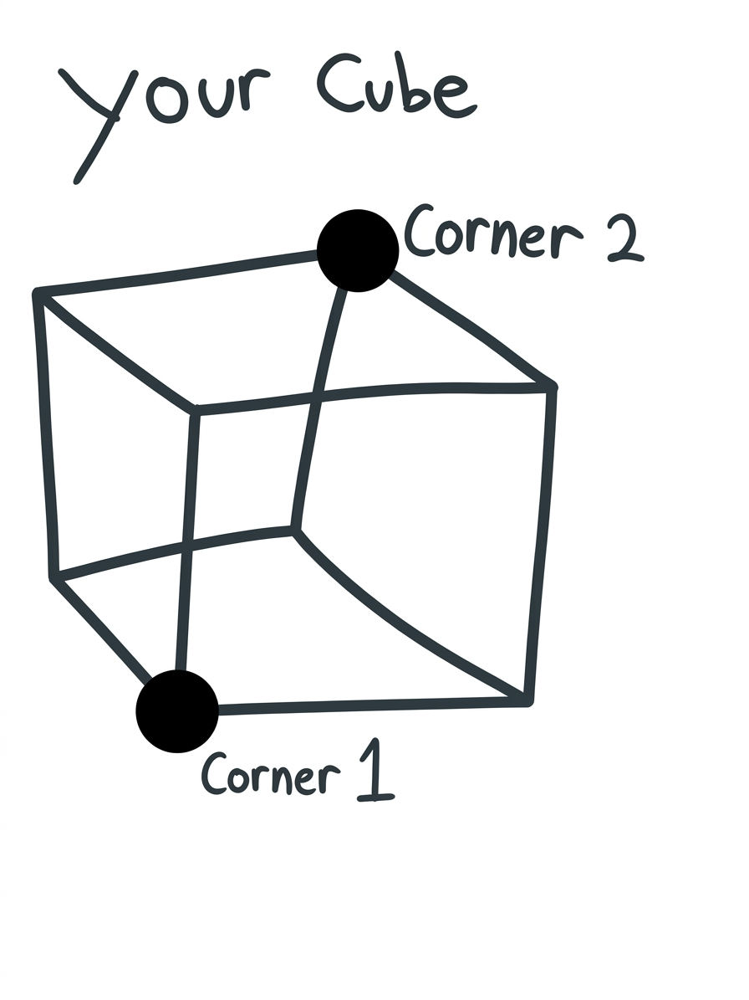

# Pm0nsterPika’s Minecraft Bedrock Commands
## About This Page

Minecraft Bedrock commands and how to use them!

COMING SOON: Submit requests for commands to 

## Commands

* `/fill` - allows you to fill a cube-shaped area with blocks
  * For example, making a hollow cube out of amethyst that is 3x3x3 `/fill [x y z coordinates of 1 corner] [x y z coordinates of the diagonally opposite corner] amethyst hollow` (without “hollow” it will be a solid cube
  * See picture:

